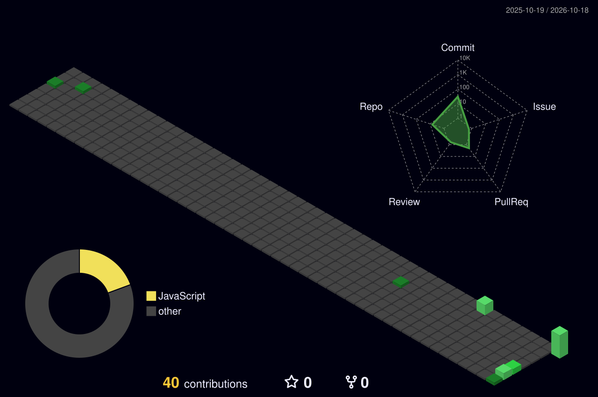

🛠️ Technologies & Tools

<h3>Cloud & DevOps</h3>

<h3>Development</h3>

🚀 Featured Project

<table>
  <tr>
    <td width="35%" align="center" valign="middle">
      
    </td>
    <td width="65%" valign="middle">
      <h3>
        <a href="https://github.com/Ahmad-000/mern-devops-automation">MERN DevOps Automation</a>
      </h3>
      
<strong>Docker · AWS EC2 · Docker Compose · GitHub Actions</strong>

      
A containerized MERN application deployed on AWS EC2, with a focus on deployment automation, containerization, and CI/CD using GitHub Actions.

      

        <a href="https://github.com/Ahmad-000/mern-devops-automation">View Project on GitHub →</a>
      

    </td>
  </tr>
</table>

📊 3D GitHub Contributions

📈 GitHub Statistics

 

🤝 Connect With Me

  

<strong>Open to DevOps, Cloud Engineering, and CI/CD opportunities.</strong>

<h3>👀 Profile Visitors</h3>

  

<em>Thanks for visiting my profile!</em>

<strong>Let's build, automate, and deploy something great. 🚀</strong>

