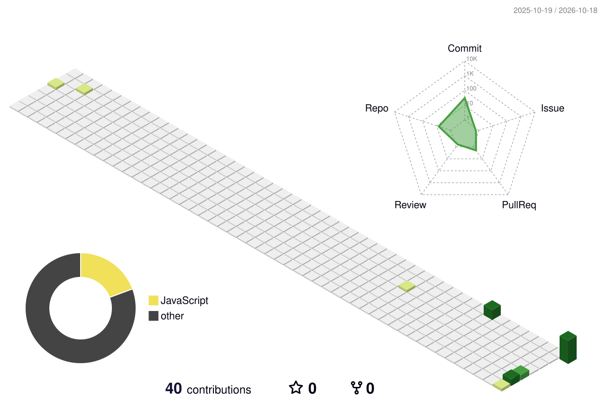

# 👋 Hi, I'm Ahmad Raza

### DevOps Engineer | Cloud & Automation Enthusiast

Building reliable applications through automation, containers, and cloud technologies.

**Docker · AWS · Azure · Linux · GitHub Actions**

---

🛠️ Technologies & Tools

Cloud & DevOps

Development

---

## 🚀 Featured Project

<table>
  <tr>
    <td width="35%" align="center" valign="middle">
      
    </td>
    <td width="65%" valign="middle">
      <h3>
        <a href="https://github.com/Ahmad-000/mern-devops-automation">
          MERN DevOps Automation
        </a>
      </h3>
      Docker · AWS EC2 · CI/CD
      

        A containerized MERN application deployed on AWS EC2,
        with automated CI/CD being implemented.
      

      <a href="https://github.com/Ahmad-000/mern-devops-automation">
        View project on GitHub →
      </a>
    </td>
  </tr>
</table>

---

  

---

 

  

🤝 Connect With Me

  

Open to DevOps, Cloud Engineering, and CI/CD opportunities.

