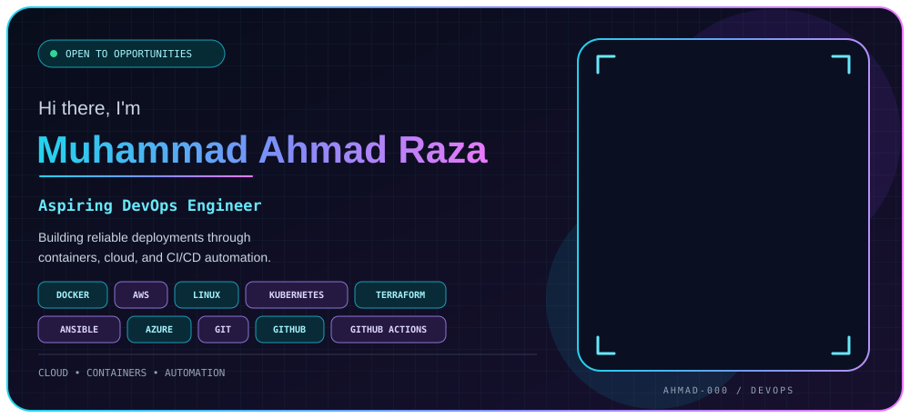
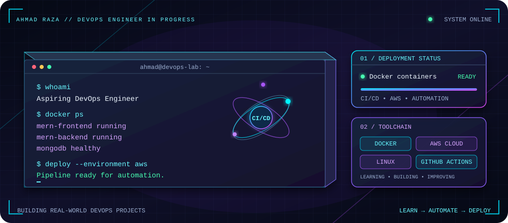
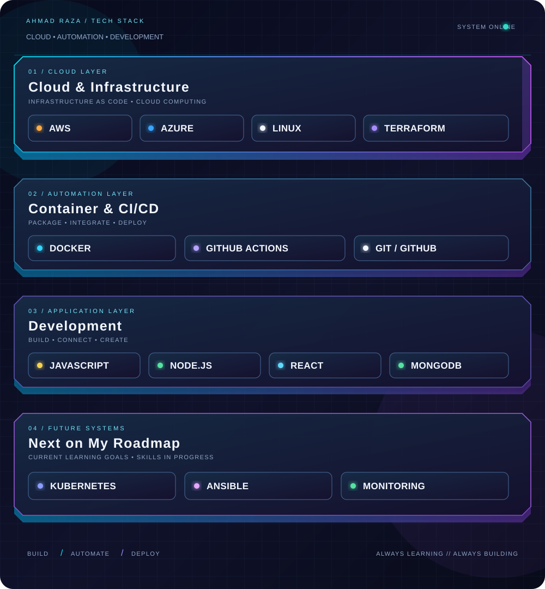
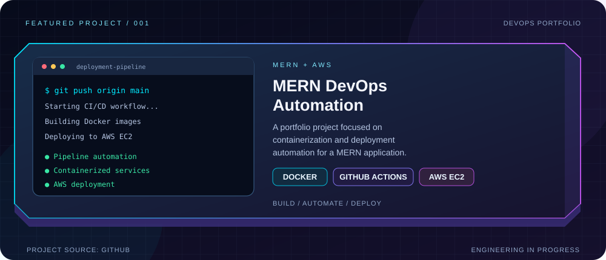
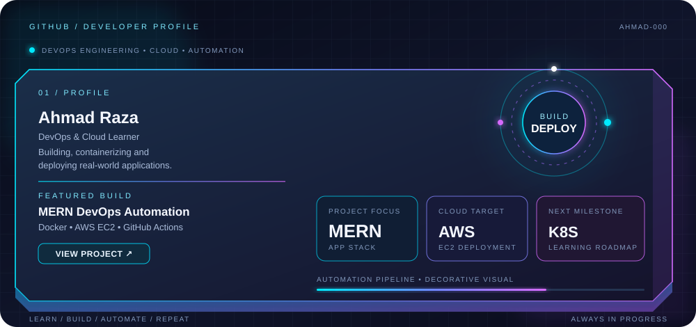
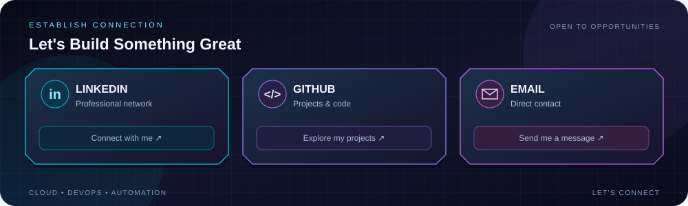

  

  

<h2 align="center">🎓 Student Identity</h2>

  

<h2 align="center">☁️ Cloud & Infrastructure</h2>

  

<h2 align="center">🚀 Featured Project</h2>

  

  

    <a href="https://github.com/Ahmad-000/mern-devops-automation">Explore the project on GitHub →</a>
  

<h2 align="center">📊 GitHub Activity</h2>

  

<h2 align="center">🌐 Connect With Me</h2>

  

  

    <a href="https://www.linkedin.com/in/muhammad-ahmed-raza-devops/">LinkedIn</a>
    &nbsp; • &nbsp;
    <a href="https://github.com/Ahmad-000">GitHub</a>
    &nbsp; • &nbsp;
    <a href="mailto:ahmad.ah1035@gmail.com">Email</a>
  

<h2 align="center">👁️ Profile Visitors</h2>

  

  

